# ARROW OF TIME

## An Interactive Physics Adventure & Scientific Learning Platform

\<p align="center">   \<strong>Explore the universe. Understand the laws of physics. Build the future.\</strong> \</p>

\<p align="center">   ![React]\([https://img.shields.io/badge/React-Frontend-61DAFB?logo=react&logoColor=black](https://img.shields.io/badge/React-Frontend-61DAFB?logo=react\&logoColor=black))   ![Vite]\([https://img.shields.io/badge/Vite-Build%20Tool-646CFF?logo=vite&logoColor=white](https://img.shields.io/badge/Vite-Build%20Tool-646CFF?logo=vite\&logoColor=white))   ![JavaScript]\([https://img.shields.io/badge/JavaScript-ES%20Modules-F7DF1E?logo=javascript&logoColor=black](https://img.shields.io/badge/JavaScript-ES%20Modules-F7DF1E?logo=javascript\&logoColor=black))   ![Lessons]\([https://img.shields.io/badge/Lessons-400-blue](https://img.shields.io/badge/Lessons-400-blue))   ![Project]\([https://img.shields.io/badge/Project-Physics%20Education-purple](https://img.shields.io/badge/Project-Physics%20Education-purple))   ![Status]\([https://img.shields.io/badge/Status-Complete-success](https://img.shields.io/badge/Status-Complete-success)) \</p>

---

# Table of Contents

1. [Project Overview](#1-project-overview)
2. [Project Vision](#2-project-vision)
3. [Core Features](#3-core-features)
4. [Learning Architecture](#4-learning-architecture)
5. [Curriculum Structure](#5-curriculum-structure)
6. [Application Architecture](#6-application-architecture)
7. [Technology Stack](#7-technology-stack)
8. [Repository Structure](#8-repository-structure)
9. [Lesson Module Architecture](#9-lesson-module-architecture)
10. [Lesson Navigation and Discovery](#10-lesson-navigation-and-discovery)
11. [Interactive Physics Workbenches](#11-interactive-physics-workbenches)
12. [Scientific Computing and Equations](#12-scientific-computing-and-equations)
13. [Progress Tracking](#13-progress-tracking)
14. [User Interface and Experience](#14-user-interface-and-experience)
15. [Application Data Flow](#15-application-data-flow)
16. [Installation and Setup](#16-installation-and-setup)
17. [Development Workflow](#17-development-workflow)
18. [Testing and Quality Assurance](#18-testing-and-quality-assurance)
19. [Security, Accessibility and Reliability](#19-security-accessibility-and-reliability)
20. [Deployment and Production](#20-deployment-and-production)
21. [Extending the Curriculum](#21-extending-the-curriculum)
22. [Contributing](#22-contributing)
23. [Educational Methodology](#23-educational-methodology)
24. [Scientific Limitations and Responsible Use](#24-scientific-limitations-and-responsible-use)
25. [Roadmap](#25-roadmap)
26. [License and Acknowledgements](#26-license-and-acknowledgements)

---

# 1. Project Overview

**Arrow of Time** is an interactive physics education platform designed to take learners from foundational physical principles toward advanced scientific concepts.

The application combines structured lessons, worked examples, conceptual explanations, practice exercises, investigations, interactive models and progress tracking into one educational environment.

Rather than functioning as a conventional digital textbook, the application is organized as a physics adventure. Learners move through progressively more advanced scientific subjects, develop mathematical reasoning skills, investigate physical systems and connect abstract equations to observable phenomena.

The curriculum contains 400 individually organized lesson modules.

## Project goals

- Make complex physics concepts accessible through structured explanations.
- Connect mathematical equations to physical interpretations.
- Encourage experimentation through interactive models.
- Develop scientific reasoning rather than memorization alone.
- Support independent study and progressive learning.
- Provide a structured environment for reviewing completed material.
- Connect classical physics to modern theoretical and experimental science.

## Educational scope

The curriculum includes:

| Domain               | Representative subjects                                    |
| -------------------- | ---------------------------------------------------------- |
| Classical mechanics  | Motion, forces, momentum and energy                        |
| Rotational mechanics | Angular motion and rotational dynamics                     |
| Thermal physics      | Temperature, heat and thermodynamic principles             |
| Waves and optics     | Oscillations, interference and electromagnetic radiation   |
| Electromagnetism     | Electric fields, magnetic fields and induction             |
| Modern physics       | Relativity and quantum foundations                         |
| Nuclear physics      | Nuclear structure and radioactive decay                    |
| Astrophysics         | Stars, compact objects and black holes                     |
| Cosmology            | Expansion, cosmic background radiation and dark matter     |
| Plasma physics       | Charged particles and collective electromagnetic behaviour |
| Quantum information  | Entanglement, measurement and quantum computing            |
| Research methods     | Evidence, reproducibility and scientific communication     |

The application is intended for advanced secondary-school learners, independent students, educators and introductory university-level exploration.

---

# 2. Project Vision

The central idea behind Arrow of Time is that physics should be experienced as a connected system of explanations.

A learner studying gravity should eventually encounter orbital mechanics, stellar structure, black holes and cosmology. A learner studying waves should be able to connect oscillations to optics, electromagnetic radiation and quantum behaviour.

The project therefore emphasizes conceptual continuity.

## The learning progression

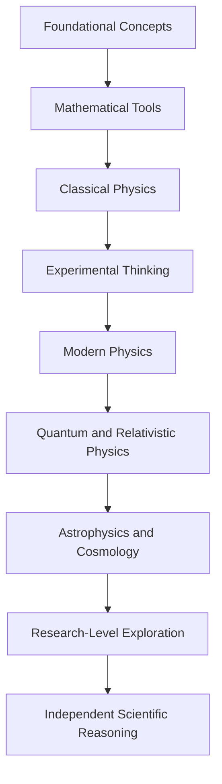

## Design principles

### 2.1 Understand before calculating

Equations are presented as descriptions of physical relationships, not isolated symbols.

### 2.2 Experiment before accepting

Interactive models encourage learners to change variables, observe effects and formulate predictions.

### 2.3 Progress through connections

Topics are organized so that earlier concepts become tools for understanding later ones.

### 2.4 Separate models from reality

Scientific models have assumptions. Learners are encouraged to identify those assumptions and understand where a model may stop being accurate.

### 2.5 Encourage independent investigation

The platform includes exercises that ask learners to design experiments, interpret observations and evaluate competing explanations.

---

# 3. Core Features

## 3.1 Structured lesson system

The curriculum consists of 400 individual JavaScript lesson modules.

Each lesson is designed to contain a consistent set of learning elements:

- Lesson identification and title.
- Central concept or summary.
- Learning objectives.
- Key terminology.
- Worked-example discussion.
- Practice questions.
- Investigation activities.
- Common misconceptions.
- Reflection or exit-ticket questions.

This consistent organization makes the curriculum easier to navigate, maintain and expand.

## 3.2 Interactive learning

The application includes physics workbench components that allow learners to manipulate variables and observe calculated results.

Examples include:

- Motion and mechanics models.
- Energy and force explorations.
- Relativity calculators.
- Astrophysics relationships.
- Cosmological scaling demonstrations.
- Plasma physics estimates.
- Magnetic-field calculations.

## 3.3 Progress management

The application includes learner progress functionality to support ongoing study.

The intended learning workflow is:

1. Open a lesson.
2. Read the explanation.
3. Work through the example.
4. Complete practice.
5. Record the result or reflection.
6. Continue to the next lesson.

## 3.4 Search and navigation

The lesson collection is designed for discovery by title, subject area and curriculum sequence.

## 3.5 Notes and study support

Learners can use the application's study tools to organize notes and revisit concepts.

## 3.6 Theme support

The interface includes visual theme support to make extended study sessions more comfortable.

---

# 4. Learning Architecture

Arrow of Time separates the learning experience into several complementary layers.

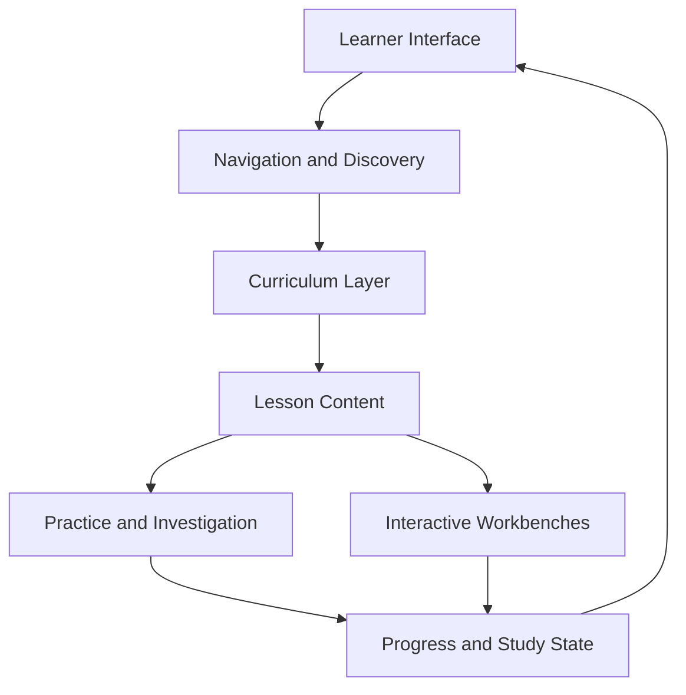

## Layer 1: Presentation

The presentation layer displays lesson information, navigation, controls and interactive learning elements.

## Layer 2: Curriculum

The curriculum layer organizes lessons into subjects, sequences and broader educational areas.

## Layer 3: Content

The content layer provides the explanatory material, worked examples, vocabulary and activities.

## Layer 4: Simulation

The simulation layer allows learners to change model parameters and observe calculated outputs.

## Layer 5: Progress

The progress layer supports learner continuity and study organization.

This separation makes it possible to expand the curriculum without redesigning the entire interface.

---

# 5. Curriculum Structure

The 400 lessons are organized into progressive subject areas.

The following is a high-level curriculum map.

```mermaid
flowchart TD
    A["Arrow of Time Curriculum"]
    A --> B["Foundations"]
    A --> C["Classical Physics"]
    A --> D["Modern Physics"]
    A --> E["Space and Cosmology"]
    A --> F["Advanced Research"]

    B --> B1["Units and Measurement"]
    B --> B2["Mathematics"]
    B --> B3["Motion"]

    C --> C1["Mechanics"]
    C --> C2["Energy"]
    C --> C3["Thermodynamics"]
    C --> C4["Electromagnetism"]
    C --> C5["Waves and Optics"]

    D --> D1["Relativity"]
    D --> D2["Quantum Mechanics"]
    D --> D3["Nuclear Physics"]
    D --> D4["Particle Physics"]

    E --> E1["Stellar Evolution"]
    E --> E2["Black Holes"]
    E --> E3["Gravitational Waves"]
    E --> E4["Cosmology"]

    F --> F1["Advanced Models"]
    F --> F2["Scientific Computing"]
    F --> F3["Research Methods"]
```

## Curriculum philosophy

The curriculum is not simply a list of unrelated subjects.

It is designed to demonstrate how physical theories build on one another.

For example:

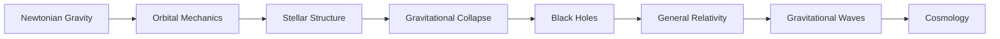

A learner can therefore revisit foundational principles as they encounter more advanced applications.

---

# 6. Application Architecture

The application uses a modular frontend architecture.

The principal responsibilities are separated into application components, lesson modules, interactive workbenches and supporting documentation.

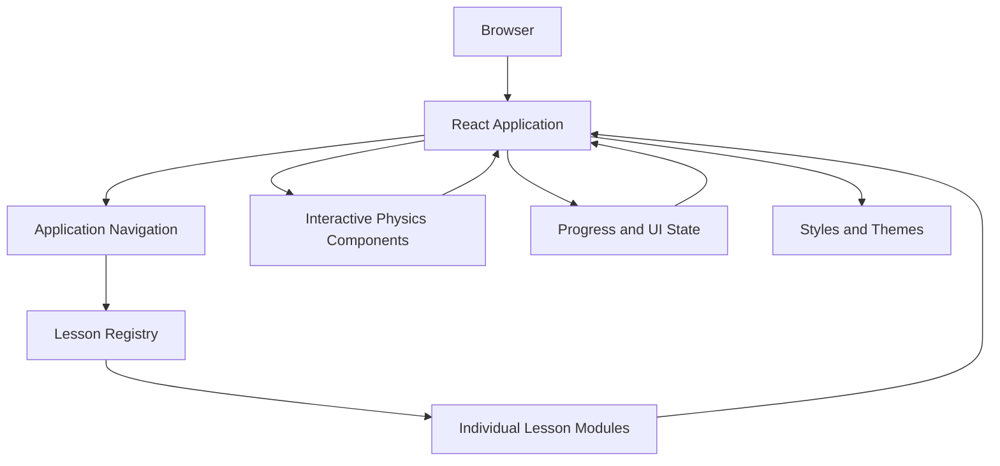

## Architecture characteristics

- React component-based presentation.
- JavaScript ES module organization.
- A centralized lesson registry.
- Individually maintained lesson modules.
- Reusable interface components.
- Dedicated interactive physics components.
- Separation between content and presentation.

The application is designed so that adding new lessons does not require rewriting every existing lesson.

---

# 7. Technology Stack

## Frontend

### React

React provides the component-based user interface.

It supports reusable elements such as:

- Lesson panels.
- Navigation elements.
- Interactive controls.
- Study cards.
- Progress displays.
- Simulation workbenches.

### JavaScript ES modules

The lesson system uses separate JavaScript modules to organize educational content.

This makes lesson maintenance more manageable than placing the entire curriculum inside one large source file.

### Vite

Vite provides the development server and frontend build tooling.

It supports fast local development and production asset compilation.

## Technology overview

| Technology | Responsibility                        |
| ---------- | ------------------------------------- |
| React      | User interface                        |
| JavaScript | Application logic and content modules |
| ES modules | Lesson organization                   |
| Vite       | Development and build tooling         |
| CSS        | Layout and visual presentation        |
| Mermaid    | Technical diagrams in documentation   |

## Architecture note

The core application is a frontend educational project. A production deployment that needs cloud accounts, cross-device synchronization, authentication or centralized storage would require corresponding backend services.

---

# 8. Repository Structure

The repository is organized to keep the curriculum, application interface and supporting documentation distinct.

A representative structure is shown below:

```text
arrow-of-time-webapp/
│
├── public/
│   └── Static application assets
│
├── src/
│   ├── App.jsx
│   ├── main.jsx
│   ├── lessons.js
│   │
│   ├── lessons/
│   │   ├── lesson-001.js
│   │   ├── lesson-002.js
│   │   ├── lesson-003.js
│   │   ├── ...
│   │   └── lesson-400.js
│   │
│   ├── VolumeFiveLab.jsx
│   ├── VolumeFourLab.jsx
│   ├── components/
│   ├── styles/
│   └── assets/
│
├── index.html
├── package.json
├── package-lock.json
│
├── README.md
├── DEVELOPER-GUIDE.md
├── EXPANSION-PACK-101-200.md
├── EXPANSION-PACK-201-300.md
└── EXPANSION-PACK-301-400.md
```

The diagram illustrates the intended organization. Exact filenames and folders should be checked against the checked-out repository when making changes.

## Important files

### `src/App.jsx`

The main application interface and composition layer.

### `src/lessons.js`

The centralized lesson registry used to collect and expose the lesson modules.

### `src/lessons/`

The individual lesson content modules.

### `src/VolumeFiveLab.jsx`

The Volume V interactive workbench containing educational calculators.

### `package.json`

The Node package manifest and application scripts.

### `README.md`

The primary developer and project documentation.

---

# 9. Lesson Module Architecture

The lesson system uses individual JavaScript modules.

A typical lesson contains structured content rather than a large block of unorganized text.

## Conceptual lesson schema

```javascript
const lesson = {
  id: 401,

  title: "Stellar Nucleosynthesis",

  concepts: "How stars build elements",

  summary: "An explanation of nuclear fusion in stellar interiors.",

  learningObjectives: [
    "Identify important stellar fusion processes.",
    "Explain energy release through mass-energy equivalence.",
    "Connect stellar evolution to elemental abundance."
  ],

  keyTerms: [
    {
      term: "Nucleosynthesis",
      meaning: "Formation of atomic nuclei."
    }
  ],

  workedExample: {
    question: "How is energy released during fusion?",

    method: [
      "Identify the initial and final nuclear states.",
      "Calculate the mass difference.",
      "Apply mass-energy equivalence."
    ],

    answer: "Energy is associated with the mass difference."
  },

  practice: [],

  investigation: {},

  misconceptions: [],

  exitTicket: []
};

export default lesson;
```

This example demonstrates the conceptual data model. It is not intended to replace an existing lesson module.

## Lesson data flow

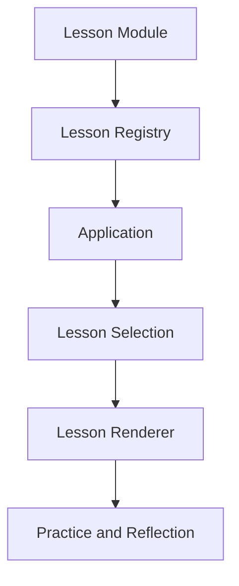

## Why individual modules?

Individual modules provide several benefits:

1. Lessons can be reviewed independently.
2. Subject matter experts can work on separate lessons.
3. Content can be expanded without rewriting the main application.
4. Lesson metadata can be standardized.
5. Curriculum errors can be isolated more easily.

---

# 10. Lesson Navigation and Discovery

The navigation system is responsible for helping learners locate the right material.

The curriculum should support several ways of moving through the application:

- Sequential progression.
- Subject-based exploration.
- Direct lesson selection.
- Search-based discovery.
- Return to previously studied lessons.

## Recommended navigation model

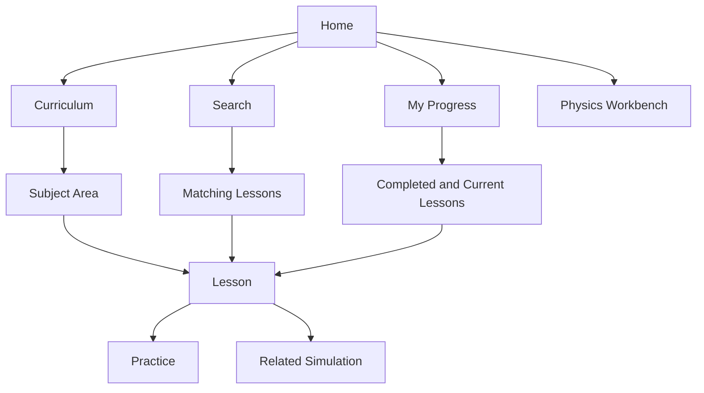

## Search design

A scalable lesson search implementation should index:

- Lesson title.
- Subject area.
- Summary.
- Key terminology.
- Lesson number.

A search result should identify the lesson clearly and provide a direct route to its content.

---

# 11. Interactive Physics Workbenches

The physics workbenches are a major part of the educational experience.

They turn mathematical relationships into experiments that learners can explore.

A workbench generally follows this structure:

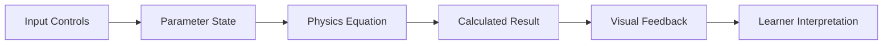

## Workbench principles

A good physics workbench should:

- Clearly label every variable.
- Display units.
- Use physically meaningful parameter ranges.
- Identify important assumptions.
- Update outputs when inputs change.
- Explain the meaning of calculated results.
- Avoid implying that simplified models represent every real-world effect.

## Example: Relativity workbench

The Lorentz factor is:

[
\gamma = \frac{1}{\sqrt{1-v^2/c^2}}
]

Where:

- (v) is relative speed.
- (c) is the speed of light.
- (\gamma) is the Lorentz factor.

The learner changes the speed and observes how the factor changes.

## Example: Black-hole workbench

The Schwarzschild radius for a non-rotating, uncharged black hole is:

[
r_s = \frac{2GM}{c^2}
]

Where:

- (G) is the gravitational constant.
- (M) is mass.
- (c) is the speed of light.

The workbench can compare a selected mass and object radius with this characteristic length scale.

## Example: Cosmology workbench

The standard background scaling of cosmic microwave background temperature is:

[
T(z)=T_0(1+z)
]

Where:

- (T_0) is the present-day background temperature.
- (z) is redshift.
- (T(z)) is the temperature at redshift (z).

This allows learners to investigate how the background temperature relates to cosmic expansion.

## Example: Plasma workbench

The electron plasma frequency is:

[
\omega_p =
\sqrt{\frac{n_e e^2}{\epsilon_0m_e}}
]

The cyclic frequency is:

[
f_p = \frac{\omega_p}{2\pi}
]

This relationship demonstrates how collective plasma behaviour depends on electron number density.

---

# 12. Scientific Computing and Equations

Scientific calculations must be presented with correct units, assumptions and appropriate numerical precision.

The application should distinguish between:

- Exact mathematical relationships.
- Approximate analytical models.
- Empirical relationships.
- Numerical simulations.
- Observationally inferred quantities.

## Dimensional analysis

Dimensional analysis provides a useful first check on equations.

For example:

[
F=ma
]

The dimensions are:

[
[F]=MLT^{-2}
]

[
[m][a]=M(LT^{-2})
]

Therefore:

[
[F]=[ma]
]

The relationship is dimensionally consistent.

## Numerical computing workflow

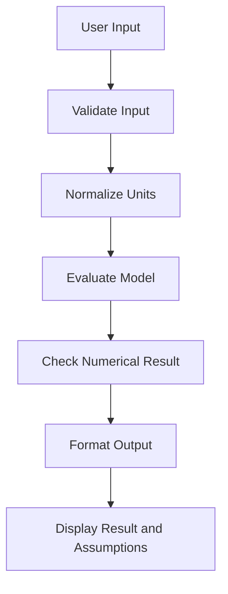

## Calculation requirements

A robust calculator should:

1. Reject invalid input.
2. Avoid division by zero.
3. Handle numerical edge cases.
4. Display meaningful units.
5. Avoid misleading precision.
6. Identify the model being used.
7. Explain any approximation.

## Numerical example: Lorentz factor

```javascript
function lorentzFactor(beta) {
  if (!Number.isFinite(beta) || beta < 0 || beta >= 1) {
    throw new Error("Speed ratio must be in the interval [0, 1).");
  }

  return 1 / Math.sqrt(1 - beta * beta);
}
```

Here, `beta` represents (v/c).

The function rejects the speed of light and superluminal inputs because the expression is not defined as a finite real Lorentz factor at those values.

---

# 13. Progress Tracking

Progress tracking provides continuity between study sessions.

A useful progress system should distinguish between:

- Lessons opened.
- Lessons currently being studied.
- Lessons completed.
- Practice attempts.
- Personal notes.
- Review priorities.

## Conceptual progress model

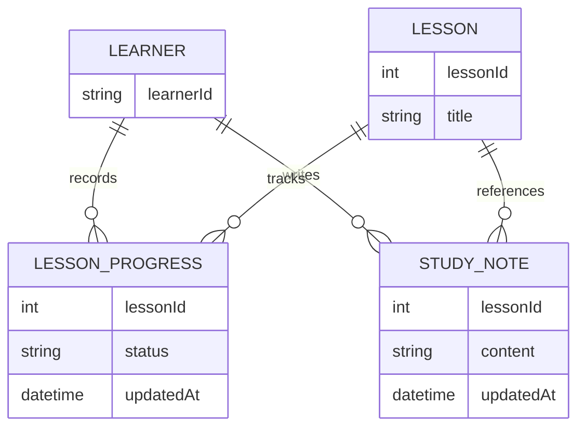

## Completion workflow

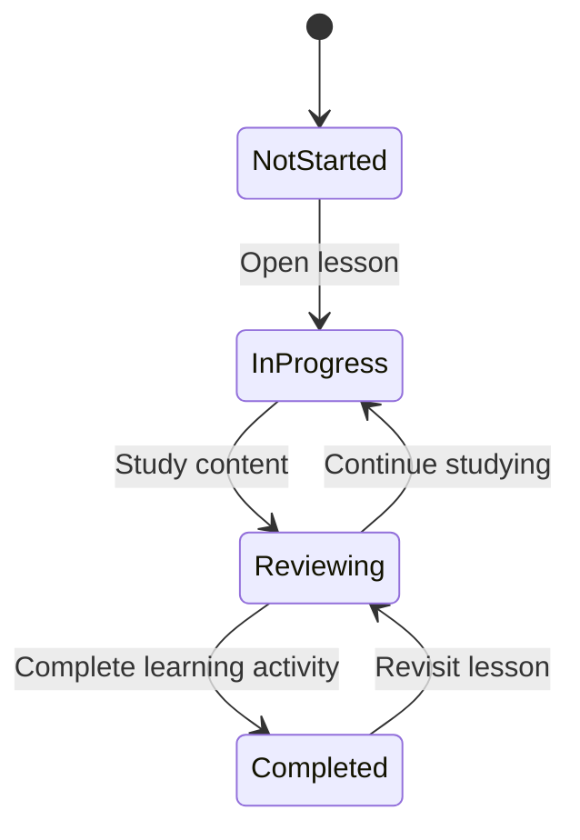

## Persistence considerations

For a local-only frontend, progress can be stored in browser storage if the implementation supports it.

For a multi-user production platform, a backend database and authenticated user accounts would be required.

A production implementation should also consider:

- Data export.
- Backup and recovery.
- Versioned progress records.
- Cross-device synchronization.
- Privacy controls.

---

# 14. User Interface and Experience

The interface should prioritize clarity, accessibility and ease of navigation.

Physics content often contains dense mathematical material, so the design should avoid unnecessary visual distractions.

## Interface priorities

### Readability

- Clear headings.
- Appropriate line length.
- Distinct sections.
- Consistent spacing.
- Legible mathematical notation.

### Navigation

- Predictable controls.
- Visible lesson identification.
- Clear subject organization.
- Direct routes back to the curriculum.

### Interaction

- Clearly labeled controls.
- Visible input values.
- Immediate feedback.
- Useful error messages.

### Responsive behaviour

The interface should remain usable on:

- Desktop computers.
- Laptops.
- Tablets.
- Mobile devices.

## Interface layout

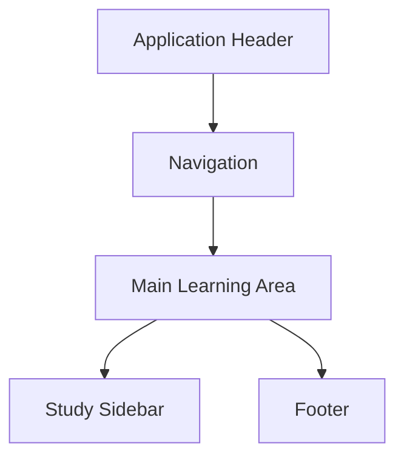

## Responsive design

A responsive layout should adapt the learning experience to available screen width.

On smaller screens:

- Multi-column content should stack.
- Controls should remain accessible.
- Navigation should collapse where appropriate.
- Text should remain readable.
- Interactive models should avoid horizontal overflow.

---

# 15. Application Data Flow

The data flow begins with the lesson registry and continues through the interface to the learner.

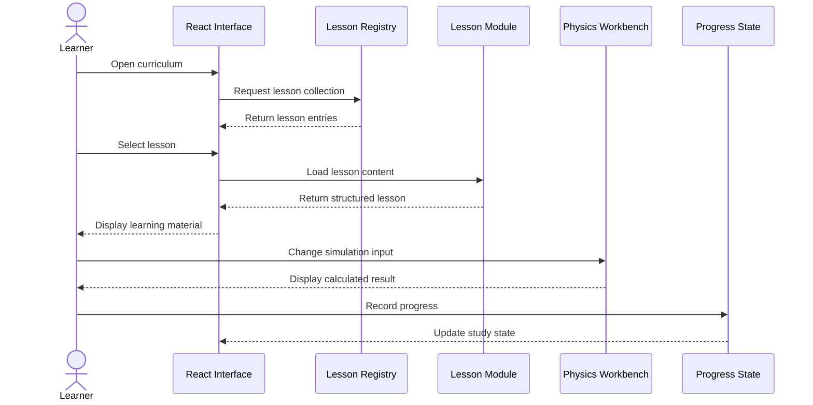

## Data responsibilities

The lesson module should remain responsible for lesson content.

The workbench should remain responsible for its calculations and interactive state.

The application should coordinate the user experience.

The progress layer should manage study continuity.

This separation reduces unnecessary coupling.

---

# 16. Installation and Setup

## Requirements

Install the following:

- Node.js, using a currently supported LTS release.
- npm.
- Git.
- A modern web browser.
- A code editor such as Visual Studio Code.

## Clone the repository

```bash
git clone https://github.com/YOUR-USERNAME/arrow-of-time-webapp.git
```

Enter the project directory:

```bash
cd arrow-of-time-webapp
```

## Install dependencies

```bash
npm install
```

## Start the development server

```bash
npm run dev
```

Vite will print the local development address in the terminal.

Open the displayed address in your browser.

## Build the application

```bash
npm run build
```

## Preview the production build

```bash
npm run preview
```

The commands above assume the corresponding scripts are present in `package.json`.

## Common setup problems

### Node.js version

Use a supported Node.js release compatible with the project's dependencies.

### Missing dependencies

Run:

```bash
npm install
```

### Port already in use

Vite may select another available port. Check the terminal output.

### Module resolution errors

Check:

- Import paths.
- File extensions.
- Capitalization.
- Registry imports.
- Whether the target file exists.

---

# 17. Development Workflow

A recommended development workflow keeps changes small and reviewable.

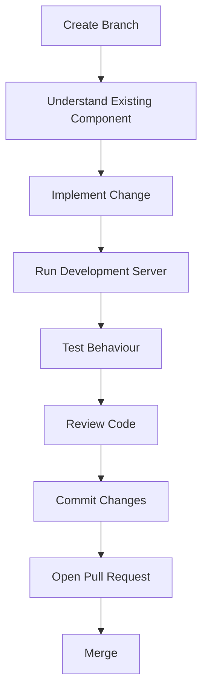

## Branch naming

Examples:

```text
feature/new-physics-workbench
feature/lesson-search
fix/lesson-navigation
docs/curriculum-update
refactor/progress-state
```

## Commit messages

Use descriptive commit messages:

```text
feat: add plasma physics workbench

feat: expand lesson search

fix: validate simulation inputs

docs: update curriculum architecture

refactor: separate lesson metadata
```

## Code review checklist

Before submitting a change:

- Does the application still start?
- Are imports correct?
- Are lesson identifiers unique?
- Are equation assumptions explained?
- Are units displayed?
- Are input ranges valid?
- Are error conditions handled?
- Does the interface remain usable on mobile?
- Has documentation been updated?

---

# 18. Testing and Quality Assurance

Educational software needs both software testing and scientific-content review.

A calculator may render correctly but still contain a physics error. A lesson may be scientifically sound but difficult to navigate.

Both dimensions must be evaluated.

## Testing layers

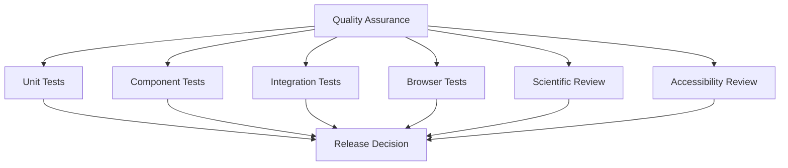

## Unit testing

Test individual calculation functions.

Example:

```javascript
import { describe, expect, it } from "vitest";

function lorentzFactor(beta) {
  if (beta < 0 || beta >= 1) {
    throw new Error("Invalid speed ratio");
  }

  return 1 / Math.sqrt(1 - beta ** 2);
}

describe("lorentzFactor", () => {
  it("returns one at zero speed", () => {
    expect(lorentzFactor(0)).toBe(1);
  });

  it("increases with speed", () => {
    expect(lorentzFactor(0.8)).toBeCloseTo(1.6667, 3);
  });

  it("rejects the speed of light", () => {
    expect(() => lorentzFactor(1)).toThrow();
  });
});
```

This example illustrates a testing pattern. A test runner must be installed and configured before the test can be executed.

## Integration testing

Check that:

- The registry contains the expected lessons.
- Lesson identifiers are unique.
- Lesson selection displays the correct content.
- Navigation returns to the curriculum.
- Workbench controls update outputs.
- Progress updates do not break navigation.

## Scientific review

Review each model for:

- Correct equations.
- Correct units.
- Stated assumptions.
- Appropriate numerical limits.
- Accurate conceptual explanation.
- Distinction between idealized models and real systems.

## Suggested release checks

| Check                   | Purpose                      |
| ----------------------- | ---------------------------- |
| Dependency installation | Confirm package consistency  |
| Production build        | Catch compile-time errors    |
| Lesson registry check   | Detect missing lessons       |
| Unit tests              | Verify calculations          |
| Browser tests           | Verify user interactions     |
| Accessibility audit     | Identify interface barriers  |
| Scientific review       | Validate educational content |

---

# 19. Security, Accessibility and Reliability

## Security

The frontend should follow standard web application security practices.

Recommendations include:

- Keep dependencies updated.
- Avoid inserting untrusted HTML.
- Validate user-provided inputs.
- Do not embed private API keys in frontend code.
- Use HTTPS in production.
- Apply a suitable Content Security Policy.
- Review third-party packages.
- Avoid storing sensitive personal information in browser storage.

## Accessibility

The application should support keyboard and assistive-technology users.

Recommended practices:

- Semantic HTML.
- Accessible form labels.
- Visible keyboard focus.
- Sufficient colour contrast.
- Descriptive button text.
- Text alternatives for meaningful graphics.
- Accessible error messages.
- Reduced-motion support where appropriate.

## Reliability

A reliable educational application should handle:

- Missing lesson data.
- Invalid numerical input.
- Empty search results.
- Unexpected calculation values.
- Browser storage failures.
- Unsupported screen dimensions.

## Error handling example

```javascript
function safeDivide(numerator, denominator) {
  if (!Number.isFinite(numerator) ||
      !Number.isFinite(denominator)) {
    throw new TypeError("Inputs must be finite numbers.");
  }

  if (denominator === 0) {
    throw new RangeError("Division by zero is undefined.");
  }

  return numerator / denominator;
}
```

---

# 20. Deployment and Production

The application can be deployed as a static frontend when its required functionality is self-contained in the browser.

Potential hosting providers include:

- GitHub Pages.
- Netlify.
- Vercel.
- Cloudflare Pages.
- Other static web hosting services.

## Deployment architecture

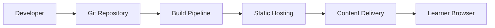

## Production build

```bash
npm run build
```

Vite typically generates a production output directory named `dist`.

The generated output should be deployed according to the hosting provider's configuration.

## Deployment checklist

- Confirm the production build succeeds.
- Configure the correct base path if deploying under a repository subpath.
- Test direct navigation and page refresh.
- Verify static assets load.
- Check responsive layouts.
- Confirm no development-only settings are exposed.
- Test the deployed application in multiple browsers.

## Backend expansion

A future cloud-enabled version may require:

- User authentication.
- Database-backed progress.
- Cloud notes.
- Multi-device synchronization.
- Administrative curriculum management.
- Analytics with privacy controls.

These services are separate architectural additions and should not be assumed to exist in the frontend-only application.

---

# 21. Extending the Curriculum

One of the most important design goals is the ability to expand the curriculum without replacing the application.

## Adding a lesson

A new lesson should follow the established module pattern.

Recommended steps:

1. Select a unique lesson identifier.
2. Choose an appropriate subject area.
3. Define learning objectives.
4. Write a concise conceptual summary.
5. Define key terminology.
6. Include a worked example.
7. Add practice questions.
8. Design an investigation.
9. Identify common misconceptions.
10. Add exit-ticket questions.
11. Register the module.
12. Verify lesson navigation.

## Curriculum extension workflow

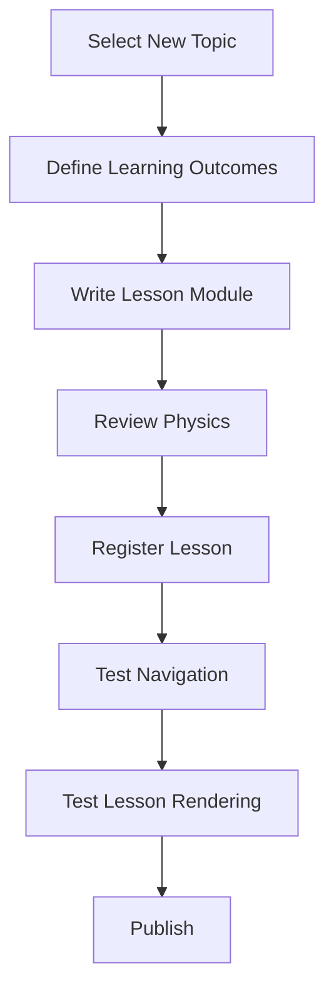

## Content quality standards

Each new lesson should:

- Introduce its topic clearly.
- Use accurate scientific language.
- Explain unfamiliar symbols.
- Use SI units where appropriate.
- Identify assumptions.
- Avoid unsupported claims.
- Include meaningful practice.
- Connect the subject to a broader physical idea.

## Example lesson topics for future development

- Numerical relativity.
- Quantum field theory.
- Gravitational-wave astronomy.
- Computational fluid dynamics.
- Advanced plasma physics.
- Quantum materials.
- High-energy astrophysics.
- Statistical mechanics.
- Scientific machine learning.
- Experimental data analysis.

---

# 22. Contributing

Contributions are welcome from developers, educators, physics students and scientific reviewers.

## Types of contributions

### Software

- Interface improvements.
- New simulations.
- Performance optimization.
- Accessibility improvements.
- Automated tests.
- Bug fixes.

### Educational content

- New lessons.
- Improved explanations.
- Worked examples.
- Practice exercises.
- Scientific references.
- Investigation activities.

### Documentation

- Setup instructions.
- Architecture explanations.
- API documentation.
- Troubleshooting guides.
- Scientific model descriptions.

## Contribution process

1. Fork the repository.
2. Create a feature branch.
3. Make a focused change.
4. Test the change.
5. Update documentation.
6. Submit a pull request.

## Pull request template

```markdown
## Summary

Describe the change.

## Motivation

Explain why it is needed.

## Implementation

Describe the technical approach.

## Testing

List tests performed.

## Documentation

List documentation changes.

## Scientific review

If applicable, identify equations, assumptions
and references reviewed.
```

## Code of conduct

Contributors should communicate respectfully, explain disagreements constructively and prioritize scientific accuracy and educational accessibility.

---

# 23. Educational Methodology

Arrow of Time combines several complementary approaches to learning.

## Conceptual instruction

Learners begin with the meaning of a physical idea before moving into advanced mathematical treatment.

## Worked examples

Examples demonstrate how to identify variables, choose equations, perform calculations and interpret results.

## Active practice

Practice questions encourage retrieval, application and transfer of knowledge.

## Investigation

Investigations encourage learners to formulate questions, make predictions and interpret evidence.

## Reflection

Exit tickets encourage learners to identify what they understand and what remains uncertain.

## Learning cycle

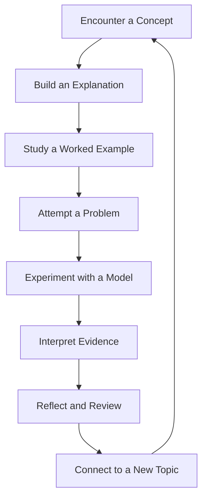

## Scientific thinking

The application encourages learners to distinguish:

- Observation from interpretation.
- Correlation from causation.
- A mathematical model from a physical object.
- Measurement uncertainty from model uncertainty.
- Established results from open research questions.

This distinction is especially important in advanced topics such as quantum theory and cosmology.

---

# 24. Scientific Limitations and Responsible Use

Physics simulations are representations of physical systems, not replacements for reality.

Every simulation has a domain of validity.

For example:

- Newtonian mechanics is highly useful at ordinary speeds and scales but is not a complete theory of relativistic motion.
- Classical electromagnetism describes a broad range of phenomena but does not replace quantum electrodynamics in all regimes.
- Ideal-gas equations are approximations that can fail under high density or strong interactions.
- Simplified black-hole calculations do not describe every feature of rotating or charged compact objects.
- Cosmological scaling relations depend on assumptions about the expansion history.

## Model transparency

Every advanced calculator should identify:

1. The equation being used.
2. The meaning of its variables.
3. The units.
4. The assumptions.
5. The limitations.
6. The intended educational interpretation.

## Safety

The application is educational software.

It should not be interpreted as authorization to conduct hazardous experiments.

High-voltage systems, lasers, radiation sources, cryogenic systems, pressure vessels and high-temperature equipment require appropriate training, supervision and safety controls.

---

# 25. Roadmap

The core curriculum and interactive learning platform provide a foundation for future development.

Potential improvements include:

| Area             | Future development                      |
| ---------------- | --------------------------------------- |
| Curriculum       | Additional advanced physics modules     |
| Simulations      | More interactive numerical models       |
| Visualization    | 2D and 3D scientific visualization      |
| Assessment       | Adaptive practice and question banks    |
| Learning support | Guided review and study recommendations |
| Accessibility    | Expanded assistive-technology support   |
| Data             | Exportable study records                |
| Cloud            | Optional account-based synchronization  |
| Research         | Dataset exploration and analysis tools  |
| Community        | Educator and contributor resources      |

## Long-term vision

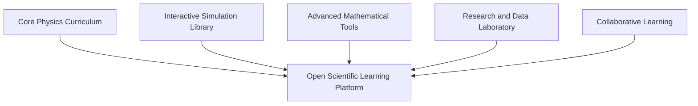

The long-term objective is to create a comprehensive environment in which learners can move from basic physical intuition to independent scientific exploration.

---

# 26. License and Acknowledgements

## License

Choose and add an explicit open-source license before publishing the repository.

Common options include:

- MIT License.
- Apache License 2.0.
- GNU General Public License v3.0.

Do not assume that the repository is licensed for unrestricted reuse until a license file is present.

## Acknowledgements

Arrow of Time builds on the work of scientists, educators and researchers whose discoveries established modern physics.

The project's educational subject areas draw on foundational contributions across:

- Classical mechanics.
- Electromagnetism.
- Thermodynamics.
- Relativity.
- Quantum mechanics.
- Nuclear and particle physics.
- Astrophysics.
- Cosmology.
- Computational science.

Scientific claims and external resources should be cited in individual lessons as the curriculum is reviewed and expanded.

---

# Final Project Summary

**Arrow of Time** is a structured, interactive physics learning environment built around a 400-lesson curriculum.

It combines:

- Modular React architecture.
- Individually organized lesson content.
- Progressive physics education.
- Interactive calculators and workbenches.
- Scientific equations and model exploration.
- Practice and investigation activities.
- Learner progress and study support.
- Technical documentation and extensibility.

The project's central educational principle is simple:

> Physics is not a collection of disconnected equations. It is a framework for understanding how the universe behaves.

From motion and energy to quantum information, black holes and cosmology, Arrow of Time is designed to help learners explore the relationships that connect the physical world.

**Explore the universe. Follow the evidence. Understand the Arrow of Time.**

---

\<p align="center">
&#x20; \<strong>ARROW OF TIME\</strong>\<br>
&#x20; \<em>Learn the laws. Explore the unknown.\</em>
\</p>
